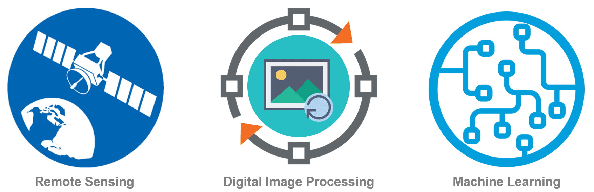

## **Subject Lecturer**
{: .h5}

- Spring 2023/2024 & Fall 2024, *Remote Sensing Image Processing*, LSGI536, Graduate Subject, 3 Credits, The Hong Kong Polytechnic University

## **Guest Lecturer**
{: .h5}

- Spring 2025, *Advanced Surveying*, LSGI548, Graduate Subject, 3 Credits, The Hong Kong Polytechnic University

- Fall 2023/2024, *Research Frontiers in Construction and Environment*, CE603, Graduate Subject, 3 Credits, The Hong Kong Polytechnic University

- Fall 2022/2023, *Big Earth Data and Geospatial AI*, LSGI1001, Undergraduate Subject, 2 Credits, The Hong Kong Polytechnic University

- 08/2022, *Remote Sensing and Machine Learning*, 3-Day Training Course for the Lands Department of The Government of the Hong Kong Special Administrative Region, The Hong Kong Polytechnic University

